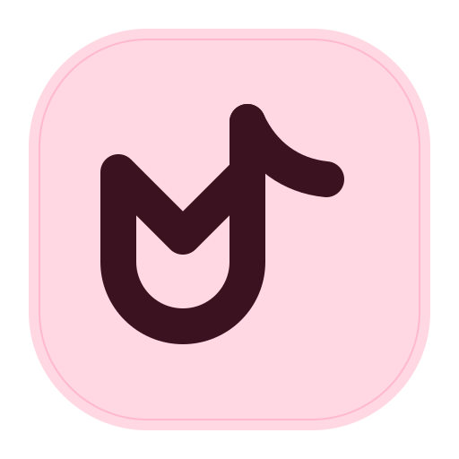
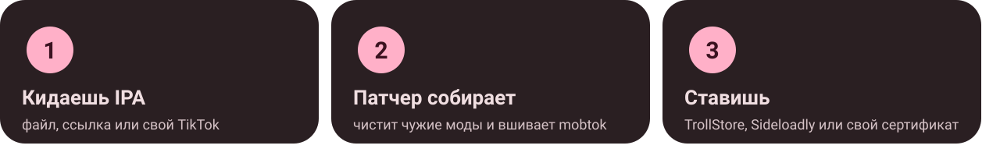

<p align="center">
  
</p>

<h1 align="center">mobtok</h1>

<p align="center">
  
</p>

<p align="center">
  <a href="../../actions/workflows/build.yml"></a>
  
  
  
</p>

<br>

Захотелось TikTok без водяных знаков, с нормальным регионом и без лишнего мусора в ленте, причём так, чтобы не садиться каждый раз за компьютер. Так появился mobtok: мод и маленький патчер к нему. Кидаешь IPA, ждёшь полминуты, ставишь. Все настройки потом живут прямо в TikTok.

<br>

<p align="center">
  
</p>

<br>

## Что внутри

<p align="center">
  
</p>

Часть функций уже работает, часть ждёт своего часа. Им нужны имена внутренних классов TikTok, а они меняются от версии к версии. Пока имени нет, функция просто молчит, TikTok от этого не ломается.

<table>
  <tr><td>🎛 Меню в стиле Material You, вход по Face ID</td><td align="center">готово</td></tr>
  <tr><td>🌫 Motion blur ленты, три режима</td><td align="center">готово</td></tr>
  <tr><td>🌍 Регион контента</td><td align="center">готово</td></tr>
  <tr><td>📥 Сохранение в «Фото»</td><td align="center">готово</td></tr>
  <tr><td>💧 Без водяного знака, качество, скорость</td><td align="center">скоро</td></tr>
  <tr><td>🚫 Без рекламы, Live и Shop</td><td align="center">скоро</td></tr>
  <tr><td>🖼 Фон профиля, приватность, перевод</td><td align="center">скоро</td></tr>
</table>

<br>

## Где взять

Свежие сборки лежат во вкладке **[Actions](../../actions)**: открываешь последний запуск **Build**, внизу в **Artifacts** забираешь `mobtok`. Внутри неподписанный патчер `mobtok-patcher-unsigned.ipa` и сам мод `mobtok.dylib`.

Патчер нужно подписать перед установкой. Подойдёт Sideloadly, TrollStore или твой сертификат.

<br>

## Как ставить мод

| | |
|:-:|---|
| 📦 | **Источник.** Свой расшифрованный `TikTok.ipa`, прямая ссылка на него или TikTok, который уже стоит на телефоне (для этого нужен TrollStore). Если в файле был другой мод, патчер его аккуратно вычистит. |
| 🔓 | **TrollStore или джейлбрейк.** Готовый IPA сразу открывается в TrollStore. |
| 💻 | **Sideloadly.** Сохраняешь IPA в «Файлы» и ставишь с компьютера. |
| 🛡 | **Сертификат.** Свои `.p12` и `.mobileprovision`. |

<br>

<details>
<summary><b>Пара честных уточнений</b></summary>
<br>

**Регион** меняет то, какую страну видит приложение. Лента и рекомендации подстроятся, но если TikTok закрыт провайдером, поможет только VPN.

**Фон профиля** — это новая официальная функция TikTok, её раскатывают не всем сразу. Мод может открыть раздел, но сохранит ли картинку сервер, зависит от TikTok.

**Motion blur** включается только на скорости и сам отключается, когда телефон греется или включён режим энергосбережения.

</details>

<details>
<summary><b>Собрать самому</b></summary>
<br>

```bash
cd tweak && make FINALPACKAGE=1
cp .theos/obj/mobtok.dylib ../patcher/MobtokPatcher/

cd ../patcher && xcodegen && open MobtokPatcher.xcodeproj
```

Понадобятся Theos, Xcode и XcodeGen.

```
patcher/   приложение-патчер на SwiftUI
tweak/     сам мод на Theos
assets/    иконки и картинки для этой страницы
```

</details>

<br>

## Спасибо

Идея выросла из **[SkyTok](https://git.skytok.site/skytok/SkyTok)**, мода от **nebesnyy**. Код mobtok написан с нуля, но без SkyTok его бы не было. Загляните к автору:

<p>
  <a href="https://t.me/SkyTok_Mod"></a>
  <a href="https://git.skytok.site/skytok/SkyTok"></a>
  <a href="https://skytok.site"></a>
</p>

<br>

<p align="center">
  
  <br>
  <sub>mobtok не связан с ByteDance и TikTok. Это неофициальный мод, ставите на свой страх и риск.</sub>
</p>
