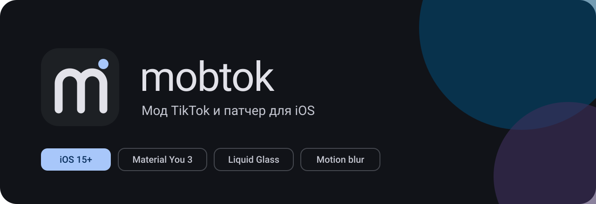
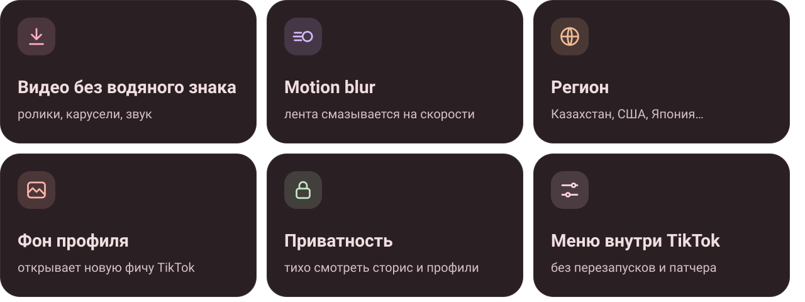

<p align="center">
  
</p>

<p align="center">
  <a href="../../actions/workflows/build.yml"></a>
  
  
  
</p>

<p align="center">
  <b>Соберите мод TikTok за пару минут — прямо на iPhone.</b><br>
  Патчер в стиле Liquid Glass, меню мода внутри TikTok в Material You 3.
</p>

---

## ✦ Что умеет

<p align="center">
  
</p>

| | Функция | Статус |
|:-:|---|:-:|
| 🎛 | Меню M3 в TikTok: чипы-фильтры, переключатели, вход по Face ID | ✅ |
| 🌫 | Motion blur по скорости свайпа, 3 режима, автоотключение при перегреве | ✅ v1 |
| 🌍 | Регион контента: локаль, оператор, параметры запросов | ✅ |
| 📥 | Загрузчик в «Фото»: видео и карусели | ✅ |
| 💧 | Без водяного знака · качество · скорость · громкость | 🛠 адаптер |
| 🚫 | Без рекламы · скрыть Live и Shop · автопрокрутка | 🛠 адаптер |
| 🖼 | Фон профиля · приватность · перевод · история | 🛠 адаптер |

> **🛠 адаптер** — функция написана, но ждёт имён классов TikTok в [`tweak/src/MTAdapter.x`](tweak/src/MTAdapter.x). До этого она просто не включается, TikTok работает как обычно.

---

## ✦ Как это работает

```
 TikTok.ipa ──▶ распаковка ──▶ проверка ──▶ mobtok.dylib ──▶ упаковка ──▶ mobtok.ipa
                                             + LC_LOAD_WEAK_DYLIB
```

1. **Источник.** Свой расшифрованный `TikTok.ipa` или расшифровка установленного TikTok (TrollStore / джейлбрейк).
2. **Патч.** Патчер встраивает мод и пересобирает IPA. Всё на устройстве, без компьютера.
3. **Установка** — на выбор:

| Способ | Как |
|---|---|
| 🔓 **Джейлбрейк / TrollStore** | IPA сразу открывается в TrollStore |
| 💻 **Sideloadly** | Сохранить IPA → поставить с ПК |
| 🛡 **Сертификат** | Свой `.p12` + `.mobileprovision` |

---

## ✦ Скачать

Готовые сборки — во вкладке **[Actions](../../actions)** → последний запуск **Build** → **Artifacts** → `mobtok`.

Внутри неподписанный `mobtok-patcher-unsigned.ipa` и `mobtok.dylib`. Подпишите IPA через Sideloadly, TrollStore или свой сертификат.

---

## ✦ Сборка из исходников

```bash
# 1. мод
cd tweak && make FINALPACKAGE=1            # нужен Theos
cp .theos/obj/mobtok.dylib ../patcher/MobtokPatcher/

# 2. патчер
cd ../patcher && xcodegen && open MobtokPatcher.xcodeproj
```

<details>
<summary><b>Структура репозитория</b></summary>

```
patcher/            приложение-патчер (SwiftUI, iOS 15+)
  App/              точка входа, навигация по шагам
  Views/            экраны: приветствие, дисклеймер, источник, установка
  Core/             IPAPatcher, Mach-O инжектор, установщики
  Theme/            Liquid Glass, M3-кнопки, анимации
tweak/              мод (Theos, Logos/ObjC)
  src/MTSettings    меню M3 внутри TikTok
  src/MotionBlur    размытие по скорости свайпа
  src/Region        подмена региона контента
  src/MTDownloader  сохранение в «Фото»
  src/MTAdapter     связь с внутренностями TikTok
assets/             иконки и графика README
```
</details>

<details>
<summary><b>Подробнее о функциях</b></summary>

**Motion blur.** Радиус размытия ≈ путь ленты за половину кадра — как затвор 180° в After Effects. Медленный скролл остаётся чётким. Выключается при энергосбережении, перегреве и «Уменьшении движения». Следующий шаг — направленный Metal-шейдер.

**Регион контента.** Меняет страну, которую видит приложение, а с ней ленту и рекомендации. Блокировку по IP это не обходит — для этого нужен VPN.

**Фон профиля.** Официальная функция TikTok, которую выкатывают постепенно. Мод может открыть раздел в приложении, но сохранение решает сервер TikTok: если аккаунт не в тесте, загрузку могут отклонить.

**Подпись на устройстве.** Подключается через zsign — точка входа `Installer.install`, ветка `.certificate`.
</details>

---

## ✦ Благодарности

mobtok вдохновлён **[SkyTok](https://git.skytok.site/skytok/SkyTok)** от **nebesnyy**. Код mobtok написан заново, из SkyTok он не скопирован.

<p>
  <a href="https://t.me/SkyTok_Mod"></a>
  <a href="https://git.skytok.site/skytok/SkyTok"></a>
  <a href="https://skytok.site"></a>
</p>

---

<sub>mobtok — неофициальный мод, не связан с ByteDance и TikTok. Используете на свой риск: аккаунт могут ограничить.</sub>
